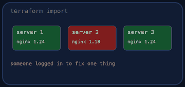
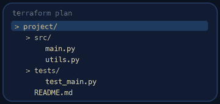
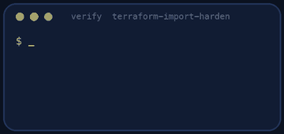
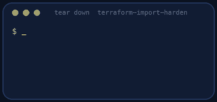

<p align="center"></p>

| | |
|-|-|
| **Time** | 75-90 min |
| **Cost** | free (S3 pennies) |
| **You need** | An AWS administrator user (the IAM lab), the AWS CLI v2, Terraform 1.10 or newer, git and a terminal |

## How this lab works

1. **Fork** this repository to your own GitHub account (button at the top right).
2. Clone **your fork** in your Ubuntu environment (WSL on Windows, your OrbStack machine on Mac).
3. Read the lab below (the same text is in [`LAB.md`](LAB.md)) and follow the mission.
4. Answer the questions in [`SUBMISSION.md`](SUBMISSION.md). Where a question asks for output, paste it in a code block. No screenshots needed.
5. Commit and push. Open the **Actions** tab of your fork (click *I understand my workflows, go ahead and enable them* the first time). The **Lab check** shows what is still missing.
6. When the check is green, **submit the URL of your fork** in the course platform.

> [!NOTE]
> The check only looks at your answers and any files the lab asks you to commit. Your instructor reads your work and may ask you to explain any line.

<p align="center"></p>

## 🎬 The situation

<p align="center"></p>

**Audit request AR-0147** - *Marketing click-export bucket*

| Item | Finding |
|------|---------|
| Owner | an intern who has left |
| Content | three months of customer click data |
| Versioning | none |
| Tags | none |
| Lifecycle rule | none |
| Policy | none |
| In code | no, created by hand in the console |

The CTO asks two questions: *"Can you put it under Terraform without losing a single file?"* and *"Can you make sure nobody can quietly change it again?"* A new bucket plus a copy is the lazy answer, and it breaks every link that points to the old one. You will **adopt** the existing bucket with an `import` block, harden it in code one setting at a time, and catch a colleague who changes it behind your back.

> [!IMPORTANT]
> **Your mission**
> - Bring the existing bucket under Terraform with an `import` block, **without replacing it**
> - Make it safe in code: public access blocked, versioning, encryption, a lifecycle rule and HTTPS-only
> - Read a plan like a contract before you apply it
> - Detect and undo drift, then tear it all down and prove it

**Time:** 75-90 min | **Cost:** free (S3 pennies) | **You need:** an AWS administrator user, the AWS CLI v2, Terraform 1.10 or newer, git and a terminal. Everything here uses `us-east-1`.

<p align="center"></p>

## Part 0 - Meet the bucket

1. **Fork** this repository, clone it, then create the intern's bucket:

```bash
./setup.sh
```

It creates `clippy-exports-<your account id>` with three customer files under `exports/`. Look at it in the console and with the CLI: what does it have, and what is missing?

```bash
B=clippy-exports-$(aws sts get-caller-identity --query Account --output text)
aws s3api get-bucket-versioning --bucket $B
aws s3api get-public-access-block --bucket $B
aws s3api get-bucket-lifecycle-configuration --bucket $B
aws s3 ls s3://$B/exports/
```

Several of these commands fail with an error. An error is information: say in one sentence what each one means.

2. Open `terraform/main.tf`. The provider and the bucket name are written for you; everything else is `TODO`.

<p align="center"></p>

## Part 1 - Adopt it (the plan is a contract)

<p align="center"></p>

Add an `import` block and a matching `aws_s3_bucket` resource named `exports`:

```hcl
import {
  to = aws_s3_bucket.exports
  id = local.bucket
}
```

```bash
cd terraform
terraform init
terraform plan
```

Read the plan **before** anything else. It must say `1 to import` and `0 to destroy`. If it wants to *replace* the bucket, stop: that would try to delete a bucket with customer files in it. Find out why.

> [!NOTE]
> **Think** The plan says `update in-place` for the bucket even though you wrote almost nothing. What is it changing? (Look at the tags: where do they come from?)

Apply it (`terraform apply`). Check that the three files are still there. The bucket is now in your state file.

<p align="center"></p>

## Part 2 - Harden it, one setting at a time

In AWS provider v6 each S3 setting is its own resource. Add them, running `terraform plan` after **each** one so you see what it promises:

| Resource | Setting |
|----------|---------|
| `aws_s3_bucket_public_access_block` | all four options `true` |
| `aws_s3_bucket_versioning` | `Enabled` |
| `aws_s3_bucket_server_side_encryption_configuration` | `AES256` |
| `aws_s3_bucket_lifecycle_configuration` | one rule: expire objects under the prefix `exports/` after **30 days**, and expire **noncurrent** versions after **30 days** |
| `aws_s3_bucket_policy` | `Deny` every request where `aws:SecureTransport` is `false` |

Notes: the lifecycle resource must wait for versioning (`depends_on`), and the policy must wait for the public access block, or AWS rejects one of them with a conflict. When Terraform says "Conflict" or "OperationAborted", that is a dependency you did not write down.

> [!NOTE]
> **Think** Why does the lifecycle rule need a *noncurrent* version rule as well? What would happen to your storage bill after a year if it only expired current versions?

> [!NOTE]
> **Think** The policy denies plain HTTP. Which of your own commands would stop working if you had denied HTTPS instead of HTTP?

Add an `output "bucket_name"`. Run `terraform apply`. Then:

```bash
terraform plan
```

It must say **No changes**. That sentence is the goal of Infrastructure as Code: the code and the real world agree.

<p align="center"></p>

## Part 3 - A colleague "fixed something"

```bash
./drift.sh
```

Somebody switched things in the console (versioning off, rule gone). You were not told. Run `terraform plan` and read it: it shows **exactly** what changed and what Terraform would do about it. Do not apply yet.

> [!NOTE]
> **Think** In a real company, how would you find out *who* changed it and when? (AWS has a service for exactly this question.) And how would you stop people from changing it by hand?

Now `terraform apply` and make the plan clean again.

<p align="center"></p>

## Part 4 - State is not a secret store, but treat it like one

Look at `terraform/terraform.tfstate`. Find the bucket in it. This file now describes your infrastructure in detail, and (for other resources) sometimes holds passwords. Check `git status`: it must not be tracked.

> [!NOTE]
> **Think** The state file sits on your laptop. Your colleague has the same repository. What happens when you both run `terraform apply`? (The next lab fixes this.)

<p align="center"></p>

## Part 5 - Prove it

<p align="center"></p>

```bash
./verify.sh
```

It checks your code, then reads the **real bucket**: that your three customer files are untouched, every protection, and that `terraform plan` finds nothing to change. Fix what is red and run it again until it ends with **ALL CHECKS PASSED**.

> [!TIP]
> **Stuck?** `BucketAlreadyOwnedByYou` on apply: you wrote the resource without the `import` block. `Conflict: A conflicting conditional operation` on the lifecycle or policy: add the `depends_on`. `terraform plan` shows changes after apply: you changed something by hand, or the lifecycle prefix differs.

<p align="center"></p>

## Level up (optional)

- Add a second bucket `clippy-exports-staging-<account>` from the same configuration with `for_each`, without copy-pasting the settings.
- Turn the five settings into a small module so any bucket in the company can be hardened the same way.
- Write the same hardening with `aws s3api` commands in a script. What does Terraform give you that the script does not?

<!-- teardown:start (generated by labs.py, do not edit) -->
## Tear down (mandatory)

<p align="center"></p>

Resources left behind cost money, keep doors open and pollute the next lab. Removing what you created is part of the job, so it is part of the submission: **you must prove it is gone**.

Do this **last**, after you have pasted your `verify` output into `SUBMISSION.md` (once you tear down, the lab can no longer be verified).

1. Run `./teardown.sh`. It runs `terraform destroy`, which needs the bucket emptied first (all versions): read what the script does. The bucket and its files are deleted. Code and answers stay.

Then run the proof:

```bash
./verify-teardown.sh
```

It prints a list of checks and must end with **TEARDOWN VERIFIED**. If it reports leftovers, remove them and run it again. Paste the full output in your submission.
<!-- teardown:end -->

<!-- submission:start (generated by labs.py, do not edit) -->
## 📬 Submission

Answer the questions in `SUBMISSION.md` in **your fork** (paste output in code blocks where asked), push, then submit the **URL of your fork**.

**Files to commit**

- `terraform/` with your `.tf` files (no state, no `.terraform/`)

**Questions to answer**

1. Paste `terraform plan` right after your import block, before you wrote any other setting. What did it show and why is it not empty?
2. Paste the plan that hardened the bucket (public access block, versioning, encryption, lifecycle rule, TLS-only policy). Why did it say `update in-place` and not `replace`? What would `replace` have done to the files?
3. Paste the `terraform plan` that detected drift after `./drift.sh` changed the bucket, and the apply that fixed it. Who changed what, and how would you find out in a real company?
4. Why does the state file contain secrets and bucket details, and why is it never committed? Where does `terraform.tfstate` live in your project right now and what is the risk of that?
5. What is the difference between `terraform import` (or an `import` block), `terraform state rm` and `terraform destroy` for a resource that already exists? When would you use each?
6. Paste the output of `./verify.sh`. It must end with **ALL CHECKS PASSED**.
7. **Tear down.** Paste the output of `./verify-teardown.sh`. It must end with **TEARDOWN VERIFIED**.
<!-- submission:end -->
